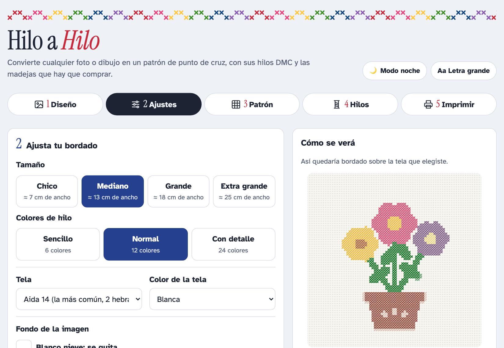
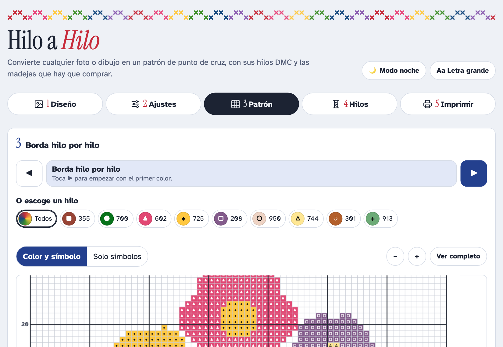

# Hilo a Hilo 🧵

> **Para mi mamá, con todo mi cariño.**
> Hice esta aplicación para tus bordados: para que conviertas en patrón cualquier foto o dibujo que te guste, sepas qué hilos comprar y vayas marcando tu avance puntada por puntada.

**Úsala aquí: <https://hilo-a-hilo.vercel.app>**: gratis, sin cuenta y sin anuncios. Funciona en el celular, la tablet y la computadora.

Hilo a Hilo convierte una foto o un dibujo en un **patrón de punto de cruz**, con sus **hilos DMC** y las **madejas** que hay que comprar en la mercería.

<p align="center">
  
  
</p>

## Por qué existe

Mi mamá borda punto de cruz, y quería darle una herramienta hecha a su medida:

- **En español sencillo**, con botones grandes y letra que se puede agrandar.
- **Que le diga qué comprar**: el número DMC de cada hilo y cuántas madejas.
- **Que imprima bien** en hojas tamaño carta.
- **Que nunca pierda su avance**, porque un bordado lleva semanas.
- **Que funcione sin internet** en su tablet Android.

Sus fotos y bordados no salen de su aparato: no hay servidor, ni cuentas, ni nada que se suba a internet.

## Qué hace

La app está organizada en 5 pasos (menú abajo en el celular, arriba en la computadora):

| Paso | Para qué sirve |
|---|---|
| **1. Diseño** | Subir una foto o un dibujo. Aquí también están *Mis bordados*, que se guardan solos. |
| **2. Ajustes** | Escoger tamaño, número de colores, tela (Aida 11, 14, 16 o 18) y su color, quitar el fondo y arreglar las letras. Al lado se ve **cómo quedaría bordado**, con la medida, la tela que hay que cortar, las puntadas y las madejas. |
| **3. Patrón** | El patrón con colores y símbolos, una guía para bordar **hilo por hilo** y el *modo bordar* para marcar los cuadritos que ya bordaste. |
| **4. Hilos** | La lista de hilos DMC con cuántas madejas comprar, lista para copiar y llevar a la mercería. |
| **5. Imprimir** | Descargar el patrón en **PDF tamaño carta**, todo en una hoja o en varias hojas con cuadros más grandes, a color o en blanco y negro. |

### Marcar el avance

- **Modo bordar:** toca un cuadrito para marcarlo. Para marcar varios del mismo color, **deja el dedo quieto un momento y arrastra**. "Deshacer" quita la última marca o la pasada completa.
- **🔍 Buscar lo que falta:** escoge un hilo y la app te lleva al siguiente cuadrito sin marcar de ese color. La lista de hilos dice cuántos faltan y cuáles ya están terminados.
- **Línea del centro:** además de los triángulos rojos, se puede mostrar una línea punteada que cruza el patrón por la mitad, en pantalla y en las hojas impresas.
- Si cambias el tamaño, los colores o las letras después de marcar puntadas, **tu avance no se borra**: aparece un aviso con el botón **"↩ Volver a como estaba"**.

### Letras que se leen bien

Las letras chicas de una imagen se vuelven manchas al convertirlas en puntadas. Para que se lean:

- En **Ajustes → Letras de tu imagen → Agregar letras a mano** escribes el texto y escoges dónde va (en curva arriba o abajo, o en renglón). La app borra las letras borrosas y las vuelve a escribir con un **abecedario de punto de cruz** de 7 cuadritos de alto, con acentos y Ñ.
- Si las letras salen de un color parecido a la tela, la app usa un tono más oscuro (o más claro) del mismo color para que contrasten.
- **Más de 35 estilos de letra**, cada uno mostrado con el texto que escribiste: 4 de cuadritos (Clásica, Gruesa, Inclinada, Chica) y tipografías de Google Fonts convertidas a puntadas (cursivas, elegantes, divertidas, de molde y antiguas). Las cursivas finas usan más cuadritos de alto para que se lean.
- Las letras se **mueven arrastrándolas** en "Cómo se verá" (con el mouse, o en el celular con "✋ Mover las letras"), o con las flechas ← ↑ ↓ →. Cada texto se puede agrandar, achicar o quitar.

### Compartir, modo noche y sin internet

- **Compartir por WhatsApp:** una imagen del bordado terminado con su nombre y medidas, o el patrón en PDF.
- **🌙 Modo noche / ☀️ Modo día:** si no escoges, sigue el tema del teléfono. El PDF siempre sale en fondo blanco.
- **Funciona sin internet** después de abrirla una vez, y se puede instalar como app ("Agregar a la pantalla de inicio").

### Mis bordados y copia de seguridad

Cada bordado (foto, ajustes, letras y avance) se guarda solo en el mismo teléfono o computadora; no se pierde al recargar ni al cerrar la página.

En *Mis bordados*, **"Guardar copia de seguridad"** descarga un archivo con todos los bordados, y **"Recuperar una copia"** los trae de vuelta en otro aparato o después de borrar el navegador. Conviene hacer una copia de vez en cuando.

## Instalarla en la tablet o el celular (Android)

Mi mamá la usa en una tablet Android. Hay dos maneras de tenerla como app, y las dos funcionan sin internet.

### Opción 1: desde Chrome (la más fácil, sin APK)

1. Abre <https://hilo-a-hilo.vercel.app> en **Chrome**, con internet.
2. Toca el menú **⋮** (arriba a la derecha) → **"Instalar app"** o **"Agregar a la pantalla de inicio"**.
3. Aparece el ícono del corazón en punto de cruz. Se abre a pantalla completa, como cualquier app.

Se actualiza sola cada vez que se publica un cambio. En iPhone o iPad: Safari → Compartir → "Agregar a inicio".

### Opción 2: un APK

Un APK sirve para pasar la app por WhatsApp o un cable a un aparato, o para subirla algún día a Google Play. La primera versión que instalé en la tablet de mi mamá fue un APK. Las envolturas sencillas de tipo WebView no siempre dejan descargar el PDF ni compartir por WhatsApp, así que conviene hacerlo con **PWABuilder**, que usa el Chrome del aparato por dentro (*Trusted Web Activity*):

1. Entra a <https://www.pwabuilder.com>, escribe `https://hilo-a-hilo.vercel.app` y toca **Start**.
2. Toca **Package for stores** → **Android** → **Generate Package**. Deja el nombre del paquete que propone (`app.vercel.hilo_a_hilo.twa`) y en *Signing key* escoge **Create new**.
3. Descarga el `.zip`. Adentro vienen:
   - el **`.apk`**, que es el que se instala en la tablet;
   - el **`.aab`**, solo para Google Play;
   - el **`signing.keystore`** y **`signing-key-info.txt`**. Guárdalos en un lugar seguro y **nunca los subas al repositorio**: sin ellos no se puede sacar una actualización del mismo APK;
   - **`assetlinks.json`**: cópialo a `.well-known/assetlinks.json` en este repositorio y súbelo. Así el APK se abre sin la barra de dirección de Chrome.
4. Pasa el `.apk` a la tablet (por WhatsApp, Drive o cable) y ábrelo. Android pedirá permiso para "instalar apps de origen desconocido".

> ⚠️ **Antes de desinstalar un APK viejo**, abre *Mis bordados* → **"Guardar copia de seguridad"**. Desinstalar una app borra los bordados que tenía guardados. Con el APK nuevo, toca **"Recuperar una copia"** y vuelven todos.

El APK no trae la app adentro: abre la página publicada y la guarda para usarla sin internet. Por eso cada cambio que se publica también le llega al APK, sin reinstalar nada.

## Cómo está hecha

- **Un solo archivo**, [`index.html`](index.html), con HTML, CSS y JavaScript, sin compilar y sin dependencias que instalar. El PDF se genera con [jsPDF](https://github.com/parallax/jsPDF), cargado desde cdnjs.
- **Colores:** cada pixel se pasa a espacio de color **Lab**, se agrupan con *k-means* y cada grupo se compara contra una paleta DMC aproximada.
- **Guardado:** IndexedDB en el navegador, con almacenamiento persistente pedido para que no se borre por falta de espacio. El avance se guarda por versión del patrón, así que cambiar un ajuste nunca borra lo bordado.
- **Sin internet:** [`sw.js`](sw.js) (service worker) y [`manifest.webmanifest`](manifest.webmanifest) la hacen una PWA instalable.
- **Sin IA ni servidor:** el código trae un buscador de diseños y un asistente que lee imágenes, pero están apagados. La app no usa ninguna clave de API ([ADR-0001](docs/reference/adrs/0001-sin-api-de-claude.md)).

La documentación está en [docs/](docs/README.md): decisiones técnicas, decisiones registradas (ADRs), análisis de apps parecidas y [la bitácora](docs/development/current/bitacora.md) de cada sesión de trabajo. Se hizo con ayuda de Claude Code; las reglas para seguir trabajando están en [CLAUDE.md](CLAUDE.md).

## Correrla en tu computadora

```bash
git clone https://github.com/Niicko12/hilo-a-hilo.git
cd hilo-a-hilo
python3 -m http.server 8765
```

Luego abre <http://127.0.0.1:8765/>.

**Pruebas** (en navegador, usan el Chrome instalado):

```bash
cd tests && npm install && npm test
```

**Publicarla:** es un sitio estático. Vercel lo sirve tal cual, sin configuración ni variables de entorno; cada push a `main` se publica solo. A mano: `vercel --prod`.

## Notas

- Los colores DMC son la equivalencia más cercana; en pantalla pueden verse un poco distintos. Conviene comparar con la madeja en mano.
- El cálculo de madejas supone madejas DMC de 8 m de 6 hebras, bordando con 2 hebras (3 en Aida 11), e incluye un poco de sobrante para rematar.
- DMC es una marca de DMC; esta app no tiene relación con la empresa.

## In English

*Hilo a Hilo* ("thread by thread") is a cross-stitch pattern maker I built for my mom. It turns a photo into a DMC pattern, counts how many skeins to buy, prints letter-size PDFs and tracks progress stitch by stitch, all offline and in a single HTML file with no backend. The interface is in Spanish.

## Licencia

[MIT](LICENSE). Si te sirve para tus bordados o los de tu mamá, úsala con gusto.
